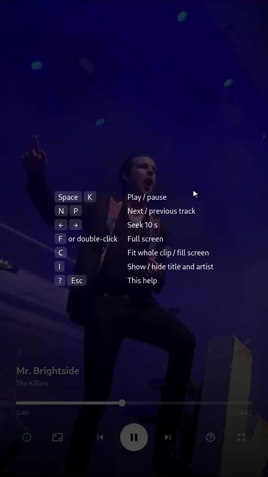
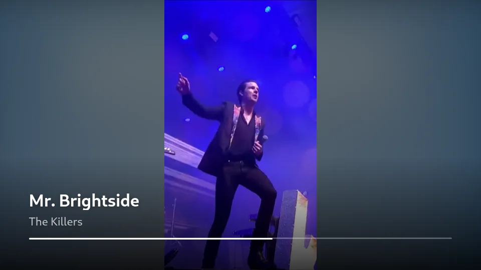

# spotify-canvas

**Spotify Canvas on a spare monitor**, like Canvas on a phone. The looping clip of whatever you're playing fills the screen. The only overlay is the title, artist and a thin progress bar, and controls appear when you move the mouse. Nothing is drawn inside Spotify.

<p align="center">
  
</p>

<p align="center">
  <a href="LICENSE"></a>
  
  
  
</p>

It works in regions where Spotify doesn't serve Canvas. The clips come from [canvasdownloader.com](https://canvasdownloader.com), and a small local service converts them to VP9 WebM and serves the display page.

## Features

- **Edge-to-edge Canvas.** The looping clip fills any window size or orientation; a monitor rotated to portrait looks most like a phone. It pauses when Spotify pauses and crossfades when the track changes.
- **Playback controls.** Move the mouse to get previous, play/pause, next and a seek bar you can click or drag. Everything fades out again after a few seconds, cursor included.
- **Fill or fit.** Crop the clip to fill the screen, or show the whole clip on a blurred copy of the cover.
- **Cover art fallback.** Tracks with no Canvas show their cover art, panning slowly.
- **Movable window that remembers its place,** or a kiosk pinned full screen to one monitor.
- **Keyboard shortcuts** for everything.
- **No Spicetify needed on Linux.** Now playing is read from Spotify's MPRIS interface on the session bus. The Spicetify extension is the source on macOS and Windows.
- **Light and local.** Python standard library plus ffmpeg, listens on `127.0.0.1` only, one request per track to the clip source, results cached on disk.

## Gallery

<table>
  <tr>
    <td align="center" width="33%"><br><sub><b>No Canvas:</b> cover art, slowly panning</sub></td>
    <td align="center" width="33%"><br><sub><b>Clip only:</b> title hidden with <kbd>I</kbd></sub></td>
    <td align="center" width="33%"><br><sub><b>Shortcuts:</b> press <kbd>?</kbd></sub></td>
  </tr>
</table>

**Fill vs. fit** on a landscape window (<kbd>C</kbd> switches):

<table>
  <tr>
    <td align="center"><br><sub>Fill: cropped edge to edge</sub></td>
    <td align="center"><br><sub>Fit: whole clip, blurred cover behind</sub></td>
  </tr>
</table>

## How it works

```
Spotify ── MPRIS (D-Bus, Linux) ──────────────┐
   └─ Spicetify extension ── POST /nowplaying ┤  (used when MPRIS isn't available)
                                              ▼
                              canvas_server.py  127.0.0.1:47800
                                │ track change → canvasdownloader.com (1 request per track, cached)
                                │ canvaz.scdn.co MP4 ─ffmpeg─▶ VP9 WebM ≤720x1280, no audio
                                │ POST /control ─▶ MPRIS PlayPause / Next / Previous / SetPosition
                                ▼
Browser window ◀── GET /view + /events (SSE) + /canvas/<id>.webm
  (opened with your session by spotify-canvas-kiosk: a movable window, or pinned to one monitor)
```

| Part | What it does | Needed |
|---|---|---|
| `service/` | Python service (stdlib only). Tracks what's playing, fetches and converts Canvas clips, serves the display page, relays playback controls. | Yes |
| `extension/spotify-canvas.js` | Spicetify extension. Reports the playing track and adds a **Canvas display** on/off toggle to Spotify's profile menu. | macOS / Windows. Optional on Linux |
| `kiosk/` | Opens the display with your session, as a movable window or pinned full screen to one monitor. GNOME on Wayland. | Optional |
| `launcher/spotify` | Spotify wrapper with GPU flags for setups where Spotify's GPU process crashes. | Optional |

## Requirements

- `python3` 3.8+, and `ffmpeg` + `ffprobe` built with libvpx-vp9
- Linux: systemd user services and `busctl` (part of systemd) for MPRIS. The service itself is plain Python and runs anywhere.
- macOS / Windows: [Spicetify](https://spicetify.app) for the extension
- A Chromium-based browser (Brave by default) for the kiosk launcher, or any browser to open `/view` yourself

No sudo and no pip packages.

## Install

### 1. Service and display page

```bash
mkdir -p ~/.local/share/spotify-canvas ~/.config/systemd/user
cp service/canvas_server.py service/view.html ~/.local/share/spotify-canvas/
cp service/spotify-canvas.service ~/.config/systemd/user/
systemctl --user daemon-reload && systemctl --user enable --now spotify-canvas
curl -s 127.0.0.1:47800/health          # {"ok": true, "mpris": true} while Spotify is running
```

On Linux that's enough for the display to follow Spotify. `"mpris": true` means the service can see it.

### 2. Extension (macOS / Windows; optional on Linux)

From the **Spicetify Marketplace**: search for `spotify-canvas` in the Extensions tab and install it.

Or by hand:

```bash
cp extension/spotify-canvas.js ~/.config/spicetify/Extensions/
spicetify config extensions spotify-canvas.js
spicetify apply
```

Restart Spotify afterwards. On Linux it only adds the **Canvas display** toggle; MPRIS still provides the track.

### 3. Show it

**Any desktop:** open `http://127.0.0.1:47800/view` in a browser. An app window keeps the browser chrome out of the way:

```bash
brave-browser --app=http://127.0.0.1:47800/view --autoplay-policy=no-user-gesture-required
```

**GNOME on Wayland, opened with your session:** install the kiosk launcher.

```bash
install -m755 kiosk/spotify-canvas-kiosk ~/.local/bin/
cp kiosk/spotify-canvas-kiosk.service ~/.config/systemd/user/
mkdir -p ~/.config/spotify-canvas
echo CANVAS_MONITOR=DP-1 > ~/.config/spotify-canvas/kiosk.env   # the monitor to open on first
systemctl --user daemon-reload && systemctl --user enable --now spotify-canvas-kiosk
```

The first launch opens the window full size on `CANVAS_MONITOR`. Move or resize it and it reopens there at the next login. For a locked kiosk instead, see [Window and pin modes](#window-and-pin-modes).

## Using it

### Controls

Move the mouse over the display and the controls fade in. They fade out again, cursor included, after about 3 seconds without activity.

<p align="center">
  
</p>

| Key | Action |
|---|---|
| <kbd>Space</kbd> / <kbd>K</kbd> | Play / pause |
| <kbd>N</kbd> / <kbd>P</kbd> (or <kbd>Shift</kbd>+<kbd>→</kbd> / <kbd>←</kbd>) | Next / previous track |
| <kbd>→</kbd> / <kbd>←</kbd> | Seek 10 s forward / back |
| <kbd>F</kbd> or double-click | Full screen |
| <kbd>C</kbd> | Fit the whole clip / fill the screen |
| <kbd>I</kbd> | Show / hide title and artist. Hidden, the display shows only the clip until you move the mouse |
| <kbd>?</kbd> / <kbd>Esc</kbd> | Shortcut help |

Fit and title settings are saved in the browser profile. Play/pause, next, previous and seek drive Spotify over MPRIS, so they need Linux. Elsewhere those buttons are hidden and the rest works.

### Window and pin modes

Set `CANVAS_MODE` in `~/.config/spotify-canvas/kiosk.env`, then `systemctl --user restart spotify-canvas-kiosk`.

| | `window` (default) | `pin` |
|---|---|---|
| Window | Normal app window: move it by the title bar or with Super+drag, resize it, full screen with <kbd>F</kbd> | Full screen on `CANVAS_MONITOR`, no window frame |
| Position | Remembered by the browser, restored at the next launch | Put back on the monitor if anything moves it |
| Closed | Stays closed until next login | Reopened within a few seconds |
| Crashed | Reopened by systemd | Reopened |
| Monitor unplugged | GNOME moves the window to another monitor | Waits, and reopens when the monitor comes back |

### Turning it off

- **For now**: in Spotify, open the profile menu and untick **Canvas display** (needs the extension). The display goes black and stops decoding, and Spotify remembers the setting. Tick it again to bring it back.
- **Close the window**: close it like any window, or `systemctl --user stop spotify-canvas-kiosk`. It comes back at the next login.
- **For good**: `systemctl --user disable --now spotify-canvas-kiosk`.

## Configuration

| Variable | Where | Default | Meaning |
|---|---|---|---|
| `CANVAS_PORT` | service, kiosk | `47800` | Port on `127.0.0.1` |
| `CANVAS_CACHE` | service | `~/.cache/spotify-canvas` | Converted clips and lookup results |
| `CANVAS_MODE` | `kiosk.env` | `window` | `window` or `pin`, see above |
| `CANVAS_MONITOR` | `kiosk.env` | `DP-1` | Connector name. Pin mode stays there; window mode opens there the first time |
| `CANVAS_BROWSER` | `kiosk.env` | `brave-browser` | Any Chromium-based browser, e.g. `google-chrome` |
| `CANVAS_KIOSK_FLAGS` | `kiosk.env` | | Extra browser flags |
| `CANVAS_KIOSK_PROFILE` | `kiosk.env` | `~/.local/share/spotify-canvas/kiosk-profile` | Browser profile for the display, separate from your normal profiles |

Set the service's variables with `systemctl --user edit spotify-canvas` (`[Service]` + `Environment=CANVAS_PORT=...`).

**Finding the monitor name.** `spotify-canvas-kiosk geometry` prints the target monitor's logical `x y w h`, or says it isn't active. Try each name from `ls /sys/class/drm` (e.g. `card1-DP-1` → `DP-1`): `CANVAS_MONITOR=HDMI-2 spotify-canvas-kiosk geometry`.

## Troubleshooting

| Symptom | Check |
|---|---|
| Display stuck on an old track | `curl -s 127.0.0.1:47800/health`. With `"mpris": false` the service can't see Spotify on the session bus, so it depends on the extension, and a silent extension leaves the last track up. The display falls back to paused after 3 minutes without reports. Is Spotify running? `busctl --user list \| grep mpris` |
| Black screen, nothing playing | Is the display turned off in Spotify's profile menu? `curl -sN 127.0.0.1:47800/events` shows `"enabled": false` then |
| Cover art instead of a clip | The track has no Canvas, or the source had an error (retried after 15 minutes). `journalctl --user -u spotify-canvas` logs `no canvas` / `error` per track |
| Playback buttons missing | No MPRIS (not Linux, or Spotify isn't on the bus). The display still follows the extension |
| Window doesn't open | `journalctl --user -u spotify-canvas-kiosk`. In pin mode, `... not active, waiting` means `CANVAS_MONITOR` is wrong |
| Spotify crashes on start or shows a blank window | See [Spotify GPU crash on Wayland](#spotify-gpu-crash-on-wayland) |

## Reference

### Service API

Listens on `127.0.0.1` only.

| Endpoint | Result |
|---|---|
| `GET /view` | The display page |
| `GET /events` | SSE stream of the state: `{enabled,id,title,artist,cover,duration,position,playing,controls,canvas,age}`. `canvas` is `"/canvas/<id>.webm"`, `"pending"` or `null`; `age` is ms since the state was reported; `controls` is true while MPRIS is available. 15 s keep-alive pings |
| `POST /control` | `{"action":"playpause"\|"play"\|"pause"\|"next"\|"previous"}` or `{"action":"seek","position":ms}`. Same origin only: other web pages get `403`, so they can't control your player. `503` without MPRIS |
| `POST /nowplaying` | From the extension: JSON `{enabled,id,title,artist,cover,duration,position,playing}`, sent as `text/plain` so there's no CORS preflight |
| `GET /lookup/<trackId>` | `200 {"ok":true,"width":720,"height":1280}` once converted · `404 {"reason":"no-canvas"}` · `502 {"reason":"error"}` |
| `GET /canvas/<trackId>.webm` | `video/webm` from the cache, with Range support. `404 not-cached` if missing |
| `GET /health` | `{"ok":true,"mpris":true}` |

### Now-playing sources

- **MPRIS (Linux).** The service runs `busctl --user get-property org.mpris.MediaPlayer2.spotify ...` once a second and publishes only real changes: a new track, play/pause, metadata, or a position more than 1.5 s off from where it should be (a seek). Nothing runs inside Spotify, so a Spotify update can't break it.
- **Extension (fallback).** Reports on song change, play/pause and seek, plus a heartbeat every 5 s, which Chromium stretches to about once a minute while Spotify's window is hidden. Its reports are ignored while MPRIS is live, except the **Canvas display** toggle. A "playing" state with no report for 3 minutes is shown as paused, so a silent extension can't leave the display running.

### Clip source and rate limiting

- One canvasdownloader request per track, at least 2 s apart, only for the track that's playing (never the queue).
- Results are cached on disk. "No canvas" is re-checked after 7 days, errors after 15 minutes.
- Clips are converted to VP9 WebM at most 720x1280, no audio, at low CPU priority. The cache is LRU-pruned at 512 MB.

### Display page

- **Canvas**: a muted, looping `<video>`, `object-fit: cover` (fill) or `contain` over a blurred cover (fit). A clip that fails to decode is retried 3 times, then falls back to the cover.
- **Overlay**: title, artist and a progress bar over a soft bottom gradient. The bar runs locally from position, duration and play state, so it moves smoothly between updates.
- **Events**: `EventSource` reconnects on its own, and the page re-opens the stream if the browser gives up.

### How pin mode stays on the monitor

Wayland clients can't choose where their windows go, so the launcher runs the browser under Xwayland (`--ozone-platform=x11`) in both modes. In pin mode it reads the monitor's logical geometry from Mutter (`org.gnome.Mutter.DisplayConfig.GetCurrentState`, which accounts for rotation and scale) and opens the browser with `--window-position`, `--window-size` and `--kiosk`.

`spotify-canvas-kiosk` then runs as a supervisor. Every 5 s it reads the window's absolute X geometry (libX11 through ctypes) and relaunches the browser if:
- the window was moved off the monitor,
- it was closed or crashed,
- the monitor's mode changed, or it was unplugged and plugged back in.

In window mode it passes `--app` instead, adds the monitor position only on the first launch, and then just waits for the browser to exit.

## Spotify GPU crash on Wayland

On some Mesa/Wayland setups, Spotify's GPU process segfaults in `eglInitialize → dri2_initialize_wayland` when it sets up hardware video decode. If Spotify crashes on start or shows a blank window, launch it through `launcher/spotify`, which adds:

```
--disable-gpu-sandbox --disable-accelerated-video-decode
```

```bash
install -m755 launcher/spotify ~/.local/bin/spotify   # make sure ~/.local/bin comes first in PATH
```

It finds Spotify in `/usr/lib64/spotify-client`, `/usr/share/spotify` or `/opt/spotify`; set `SPOTIFY_DIR` otherwise. You can also put the same flags in `spotify_launch_flags` in Spicetify's `config-xpui.ini`. `spicetify apply` relaunches Spotify without the wrapper, so restart it from your launcher afterwards.

## Surviving Spotify updates

On Linux the display keeps working through Spotify updates, because MPRIS doesn't depend on Spicetify. An update does remove Spicetify's patches, and with them the extension's toggle. Run `spicetify backup apply` after each update; `extensions = spotify-canvas.js` stays in `config-xpui.ini`, so the extension comes back with it. The service and launcher live in `$HOME`, so updates never touch them.

## Uninstall

```bash
systemctl --user disable --now spotify-canvas-kiosk spotify-canvas
rm -f ~/.config/systemd/user/spotify-canvas{,-kiosk}.service ~/.local/bin/spotify-canvas-kiosk
spicetify config extensions spotify-canvas.js-
spicetify apply
rm ~/.config/spicetify/Extensions/spotify-canvas.js
rm -rf ~/.local/share/spotify-canvas ~/.cache/spotify-canvas ~/.config/spotify-canvas
systemctl --user daemon-reload
```

## Known limits

- **Upstream site**: canvasdownloader.com can change its HTML, rate-limit, or disappear. Tracks then show the cover fallback. Cached clips keep working.
- **Spotify API**: on Linux the display reads MPRIS (title, artist, art, length, position, status). Elsewhere the extension reads `Spicetify.Player.data.item`, `getProgress`, `getDuration` and `isPlaying`, and a client update that renames these leaves the overlay blank or the progress bar at 0.
- **Pin mode placement**: depends on Mutter honouring an X11 window's requested position. A GNOME change could break this; the supervisor would then relaunch in a loop about every 25 s, which shows up in its journal. With fractional scaling, the X11 geometry may not match the logical geometry exactly, so the check could misfire. Window mode doesn't have this problem.
- **Monitor names**: connector names can change, e.g. after a GPU or driver change (`DP-1` → `DP-2`). Pin mode then waits with "not active" in its log. Set `CANVAS_MONITOR`.

## Disclaimer

Not affiliated with or endorsed by Spotify. Canvas clips, cover art and the tracks shown in the screenshots belong to their respective artists and labels; this project only displays them locally for the person playing the track. Uses an unofficial third-party source, which may stop working at any time.

## License

[MIT](LICENSE)
