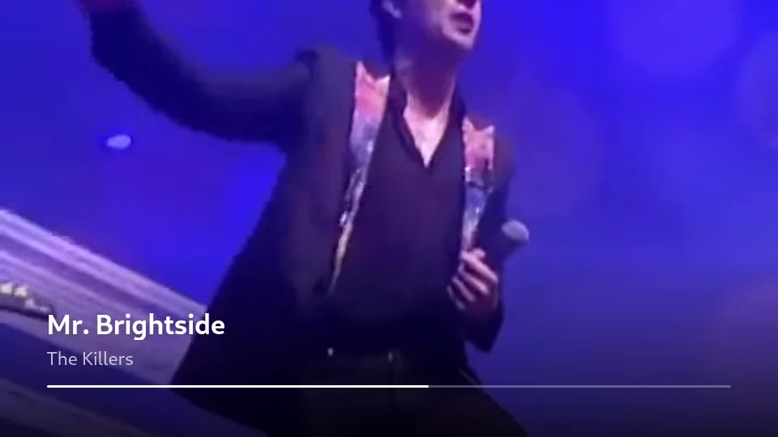
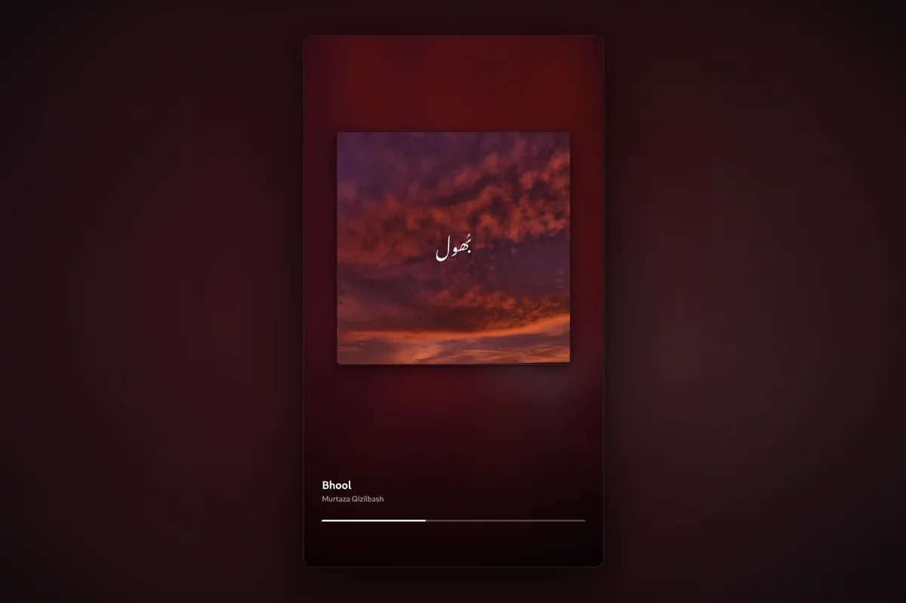
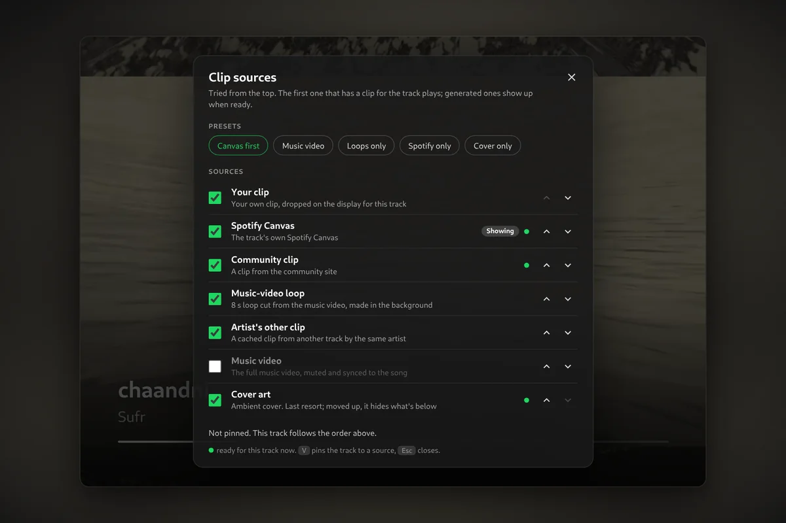

# spotify-canvas

**Spotify Canvas on a spare monitor**, like Canvas on a phone. The looping clip of whatever you're playing fills the screen. The only overlay is the title, artist and a thin progress bar, and controls appear when you move the mouse. Nothing is drawn inside Spotify.

<p align="center">
  
</p>

<p align="center">
  <a href="LICENSE"></a>
  
  
  
</p>

It works in regions where Spotify doesn't serve Canvas. The clips come from [canvasdownloader.com](https://canvasdownloader.com), and a small local service caches them and serves the display page.

## Features

- **Edge-to-edge Canvas.** The looping clip fills any window size or orientation; a monitor rotated to portrait looks most like a phone. It pauses when Spotify pauses and crossfades when the track changes.
- **Playback controls.** Move the mouse to get previous, play/pause, next and a seek bar you can click or drag. Everything fades out again after a few seconds, cursor included.
- **Auto, fit or fill.** Auto fills the screen but shows the whole clip over a blurred cover when its shape is far from the screen's (a 16:9 video on a portrait monitor). Or force either one.
- **Fast.** A new track's clip shows up about half a second after the song changes. The clip is cached as Spotify serves it, with no re-encode.
- **Clip sources you order and switch.** Seven sources (your own clip, the track's Spotify Canvas, a community clip, a music-video loop, another clip by the same artist, the full music video, the cover) tried from the top, each with an on/off switch. Presets cover the common setups; <kbd>S</kbd> opens the panel.
- **Music video, in sync.** The whole video of the song, muted, follows the song position: it pauses, seeks and resumes with Spotify. Made in the background with yt-dlp, only when it is reached in your order, and never published.
- **Pin a source per track.** <kbd>V</kbd> steps the playing track through the sources that are ready for it and remembers the choice. <kbd>Shift</kbd>+<kbd>V</kbd> unpins.
- **Artist clip fallback.** A track with no Canvas can borrow a cached clip from another track by the same artist, with a small label saying so. <kbd>A</kbd> turns this on and off.
- **Ambient cover fallback.** With no clip at all, the sharp cover floats over a slowly moving blur of its own colours, and shrinks back while paused.
- **Movable window that remembers its place,** or a kiosk pinned full screen to one monitor.
- **Keyboard shortcuts** for everything.
- **No Spicetify needed on Linux.** Now playing is read from Spotify's MPRIS interface on the session bus. The Spicetify extension is the source on macOS and Windows.
- **Light and local.** Python standard library only, listens on `127.0.0.1` only, one request per track to the clip source, results cached on disk.

## Gallery

<table>
  <tr>
    <td align="center" width="50%"><br><sub><b>Fill:</b> cropped edge to edge</sub></td>
    <td align="center" width="50%"><br><sub><b>Fit:</b> whole clip over a blurred cover (<kbd>C</kbd>)</sub></td>
  </tr>
  <tr>
    <td align="center" width="50%"><br><sub><b>No clip:</b> ambient cover</sub></td>
    <td align="center" width="50%"><br><sub><b>Clip sources:</b> order, switch, preset (<kbd>S</kbd>)</sub></td>
  </tr>
</table>

## How it works

```
Spotify ── MPRIS (D-Bus, Linux) ──────────────┐
   └─ Spicetify extension ── POST /nowplaying ┤  (used when MPRIS isn't available)
                                              ▼
                              canvas_server.py  127.0.0.1:47800
                                │ track change → canvasdownloader.com (1 request per track, cached)
                                │ canvaz.scdn.co MP4 cached as is (VP9 WebM made on demand only for browsers without H.264)
                                │ POST /control ─▶ MPRIS PlayPause / Next / Previous / SetPosition
                                ▼
Browser window ◀── GET /view + /events (SSE) + /canvas/<id>.mp4
  (opened with your session by spotify-canvas-kiosk: a movable window, or pinned to one monitor)
```

| Part | What it does | Needed |
|---|---|---|
| `service/` | Python service (stdlib only). Tracks what's playing, fetches and converts Canvas clips, serves the display page, relays playback controls. | Yes |
| `extension/spotify-canvas.js` | Spicetify extension. Reports the playing track and adds a **Canvas display** on/off toggle to Spotify's profile menu. | macOS / Windows. Optional on Linux |
| `kiosk/` | Opens the display with your session, as a movable window or pinned full screen to one monitor. GNOME on Wayland. | Optional |
| `launcher/spotify` | Spotify wrapper with GPU flags for setups where Spotify's GPU process crashes. | Optional |

## Requirements

- `python3` 3.8+
- A browser that plays H.264 (Brave, Chrome and Edge do). Otherwise also `ffmpeg` built with libvpx-vp9, so the service can make a VP9 copy
- Optional, for the music-video loop and the full music video: `yt-dlp` and `ffmpeg` on the `PATH`
- Linux: systemd user services and `busctl` (part of systemd) for MPRIS. The service itself is plain Python and runs anywhere.
- macOS / Windows: [Spicetify](https://spicetify.app) for the extension
- A Chromium-based browser (Brave by default) for the kiosk launcher, or any browser to open `/view` yourself

No sudo and no pip packages.

## Install

### 1. Service and display page

```bash
mkdir -p ~/.local/share/spotify-canvas ~/.config/systemd/user
cp service/canvas_server.py service/view.html ~/.local/share/spotify-canvas/
cp service/spotify-canvas.service ~/.config/systemd/user/
systemctl --user daemon-reload && systemctl --user enable --now spotify-canvas
curl -s 127.0.0.1:47800/health          # {"ok": true, "mpris": true} while Spotify is running
```

On Linux that's enough for the display to follow Spotify. `"mpris": true` means the service can see it.

### 2. Extension (macOS / Windows; optional on Linux)

From the **Spicetify Marketplace**: search for `spotify-canvas` in the Extensions tab and install it.

Or by hand:

```bash
cp extension/spotify-canvas.js ~/.config/spicetify/Extensions/
spicetify config extensions spotify-canvas.js
spicetify apply
```

Restart Spotify afterwards. On Linux it only adds the **Canvas display** toggle; MPRIS still provides the track.

### 3. Show it

**Any desktop:** open `http://127.0.0.1:47800/view` in a browser. An app window keeps the browser chrome out of the way:

```bash
brave-browser --app=http://127.0.0.1:47800/view --autoplay-policy=no-user-gesture-required
```

**GNOME on Wayland, opened with your session:** install the kiosk launcher.

```bash
install -m755 kiosk/spotify-canvas-kiosk ~/.local/bin/
cp kiosk/spotify-canvas-kiosk.service ~/.config/systemd/user/
mkdir -p ~/.config/spotify-canvas
echo CANVAS_MONITOR=DP-1 > ~/.config/spotify-canvas/kiosk.env   # the monitor to open on first
systemctl --user daemon-reload && systemctl --user enable --now spotify-canvas-kiosk
```

The first launch opens the window full size on `CANVAS_MONITOR`. Move or resize it and it reopens there at the next login. For a locked kiosk instead, see [Window and pin modes](#window-and-pin-modes).

## Using it

### Controls

Move the mouse over the display and the controls fade in. They fade out again, cursor included, after about 3 seconds without activity.

<p align="center">
  
</p>

| Key | Action |
|---|---|
| <kbd>Space</kbd> / <kbd>K</kbd> | Play / pause |
| <kbd>N</kbd> / <kbd>P</kbd> (or <kbd>Shift</kbd>+<kbd>→</kbd> / <kbd>←</kbd>) | Next / previous track |
| <kbd>→</kbd> / <kbd>←</kbd> | Seek 10 s forward / back |
| <kbd>F</kbd> or double-click | Full screen |
| <kbd>C</kbd> | Cycle framing: auto / fit / fill |
| <kbd>I</kbd> | Show / hide title and artist. Hidden, the display shows only the clip until you move the mouse |
| <kbd>S</kbd> | Clip sources panel: presets, order, on/off |
| <kbd>V</kbd> / <kbd>Shift</kbd>+<kbd>V</kbd> | Pin this track to its next ready source (cover included) / unpin |
| <kbd>A</kbd> | Other clips by the same artist on / off |
| <kbd>?</kbd> / <kbd>Esc</kbd> | Shortcut help (<kbd>Esc</kbd> also closes the sources panel) |

Framing and title settings are saved in the browser profile. Play/pause, next, previous and seek drive Spotify over MPRIS, so they need Linux. Elsewhere those buttons are hidden and the rest works.

### Clip sources

The gear button (or <kbd>S</kbd>) opens the sources panel: preset buttons, then one row per source with a checkbox and up/down buttons. A green dot marks the sources that have a clip for the playing track right now. The service walks the enabled sources from the top and plays the first one that has a clip. The cover is always the last resort, even when switched off, so the screen is never black; enabled and moved up, it hides everything below it.

| Source | What it is |
|---|---|
| Your clip | A video or GIF you dropped on the display for this track |
| Spotify Canvas | The track's own Canvas |
| Community clip | A clip from the community site (`CANVAS_COMMUNITY`) |
| Music-video loop | An 8 s seamless loop cut from the YouTube music video, ready about 15 s after the track starts |
| Artist's other clip | A cached clip from another track by the same primary artist |
| Music video | The full video, muted, kept in sync with the song |
| Cover art | The ambient cover |

| Preset | Order and switches |
|---|---|
| Canvas first (default) | Your clip, Spotify, community, loop, artist, cover. The full video is off |
| Music video | Your clip, **full video**, Spotify, community, loop, artist, cover |
| Loops only | Your clip, Spotify, community, loop, cover. Artist and full video are off |
| Spotify only | Spotify, cover |
| Cover only | Cover |

The music-video loop and the full video are generated in the background, and only when they come up in your order with nothing better ready: the display shows the best clip it has, then upgrades when the generated one finishes. Neither is generated while it is switched off, and neither is ever uploaded to the community site. A track pinned with <kbd>V</kbd> keeps its source for as long as that source is ready, whatever the order says, and nothing is generated for it.

The full video is the video-only stream at 1080p or less (`CANVAS_MV_HEIGHT`), so a track costs about 20 to 40 MB (the cache keeps the most recent 1 GB). The page seeks it when it drifts more than 0.35 s from the song, holds the last frame if the song outlasts the video, and doesn't compensate for an intro that the video has and the song doesn't.

Order, switches and pins are saved by the service in `settings.json` in the cache directory, not in the browser, so every display shows the same choices and the service knows which clips are worth generating.

### Window and pin modes

Set `CANVAS_MODE` in `~/.config/spotify-canvas/kiosk.env`, then `systemctl --user restart spotify-canvas-kiosk`.

| | `window` (default) | `pin` |
|---|---|---|
| Window | Normal app window: move it by the title bar or with Super+drag, resize it, full screen with <kbd>F</kbd> | Full screen on `CANVAS_MONITOR`, no window frame |
| Position | Remembered by the browser, restored at the next launch | Put back on the monitor if anything moves it |
| Closed | Stays closed until next login (a window that dies within 30 s of launching counts as a failed start and is retried) | Reopened within a few seconds |
| Crashed | Reopened by systemd | Reopened |
| Monitor unplugged | GNOME moves the window to another monitor | Waits, and reopens when the monitor comes back |

### Turning it off

- **For now**: in Spotify, open the profile menu and untick **Canvas display** (needs the extension). The display goes black and stops decoding, and Spotify remembers the setting. Tick it again to bring it back.
- **Close the window**: close it like any window, or `systemctl --user stop spotify-canvas-kiosk`. It comes back at the next login.
- **For good**: `systemctl --user disable --now spotify-canvas-kiosk`.

## Configuration

| Variable | Where | Default | Meaning |
|---|---|---|---|
| `CANVAS_PORT` | service, kiosk | `47800` | Port on `127.0.0.1` |
| `CANVAS_CACHE` | service | `~/.cache/spotify-canvas` | Converted clips, lookup results and `settings.json` |
| `CANVAS_MV` | service | `1` | `0` turns off generating music-video loops and full videos (cached ones still show) |
| `CANVAS_MV_HEIGHT` | service | `1080` | Tallest music video downloaded (360–2160). Existing cached loops and videos keep their old size |
| `CANVAS_MV_CRF` | service | `20` | x264 quality of the 8 s music-video loops (14–35, lower is sharper and bigger) |
| `CANVAS_VIDEO_CACHE_MB` | service | `1024` | Size cap for downloaded full music videos, least recently played removed first |
| `CANVAS_MODE` | `kiosk.env` | `window` | `window` or `pin`, see above |
| `CANVAS_MONITOR` | `kiosk.env` | `DP-1` | Connector name. Pin mode stays there; window mode opens there the first time |
| `CANVAS_BROWSER` | `kiosk.env` | `brave-browser` | Any Chromium-based browser, e.g. `google-chrome` |
| `CANVAS_KIOSK_FLAGS` | `kiosk.env` | | Extra browser flags |
| `CANVAS_KIOSK_PROFILE` | `kiosk.env` | `~/.local/share/spotify-canvas/kiosk-profile` | Browser profile for the display, separate from your normal profiles |

Set the service's variables with `systemctl --user edit spotify-canvas` (`[Service]` + `Environment=CANVAS_PORT=...`).

**Finding the monitor name.** `spotify-canvas-kiosk geometry` prints the target monitor's logical `x y w h`, or says it isn't active. Try each name from `ls /sys/class/drm` (e.g. `card1-DP-1` → `DP-1`): `CANVAS_MONITOR=HDMI-2 spotify-canvas-kiosk geometry`.

## Troubleshooting

| Symptom | Check |
|---|---|
| Display stuck on an old track | `curl -s 127.0.0.1:47800/health`. With `"mpris": false` the service can't see Spotify on the session bus, so it depends on the extension, and a silent extension leaves the last track up. The display falls back to paused after 3 minutes without reports. Is Spotify running? `busctl --user list \| grep mpris` |
| Black screen, nothing playing | Is the display turned off in Spotify's profile menu? `curl -sN 127.0.0.1:47800/events` shows `"enabled": false` then |
| Cover art instead of a clip | The track has no clip in any enabled source (open the sources panel with <kbd>S</kbd>: a green dot marks what is ready), or the source had an error (retried after 15 minutes). `journalctl --user -u spotify-canvas` logs `no canvas` / `error` per track |
| Music video never appears | The source is off, or a source above it had a clip. Needs `yt-dlp` and `ffmpeg`; `journalctl` shows `no usable music video` when none matched the song, which is retried after a week |
| Playback buttons missing | No MPRIS (not Linux, or Spotify isn't on the bus). The display still follows the extension |
| Window doesn't open | `journalctl --user -u spotify-canvas-kiosk`. In pin mode, `... not active, waiting` means `CANVAS_MONITOR` is wrong |
| Spotify crashes on start or shows a blank window | See [Spotify GPU crash on Wayland](#spotify-gpu-crash-on-wayland) |

## Reference

### Service API

Listens on `127.0.0.1` only.

| Endpoint | Result |
|---|---|
| `GET /view` | The display page |
| `GET /events` | SSE stream of the state: `{enabled,id,title,artist,cover,duration,position,playing,controls,canvas,source,mode,available,pin,settings,age}`. `canvas` is the clip's URL, `"pending"` while the track is being looked up, or `null` (the page shows the cover); `source` is the chosen source id; `mode` is `"loop"` or `"sync"` (the full music video, which the page keeps at the song position); `available` lists the source ids that have a clip for the track now, in your order; `pin` is the track's pinned source or `null`; `settings` is `{order,enabled}`; `age` is ms since the state was reported; `controls` is true while MPRIS is available. 15 s keep-alive pings |
| `GET /settings` | `{"order":[7 source ids],"enabled":{id:bool},"pins":{trackId:id}}`. Same origin only |
| `POST /settings` | Any of `{"order":[...],"enabled":{...},"pins":{...}}`. `order` must list all seven ids once (`custom`, `spotify`, `community`, `mv`, `artist`, `video`, `cover`); `enabled` maps known ids to booleans and is merged; `pins` maps track ids to a source id, or `null` to unpin, and is merged (the newest 2000 are kept). Anything else is `400 {"reason":"invalid","error":...}`. Same origin only (`403` otherwise), body up to 64 KB. The playing track is re-picked at once |
| `POST /control` | `{"action":"playpause"\|"play"\|"pause"\|"next"\|"previous"}` or `{"action":"seek","position":ms}`. Same origin only: other web pages get `403`, so they can't control your player. `503` without MPRIS |
| `POST /nowplaying` | From the extension: JSON `{enabled,id,title,artist,cover,duration,position,playing}`, sent as `text/plain` so there's no CORS preflight |
| `GET /lookup/<trackId>` | `200 {"ok":true}` once cached · `404 {"reason":"no-canvas"}` · `502 {"reason":"error"}` |
| `GET /canvas/<trackId>.mp4` | The clip as Spotify serves it (`video/mp4`, H.264), with Range support. `404 not-cached` if missing |
| `GET /canvas/<trackId>.webm` | VP9 copy, made with ffmpeg on first request (~5 s). The page only asks for it when the browser can't play H.264 |
| `GET /mv/<trackId>.mp4` | The 8 s music-video loop, with Range support |
| `GET /mv/<trackId>.full.mp4` | The full music video (video only, `CANVAS_MV_HEIGHT` or less, 1080p by default, H.264 where YouTube has it), with Range support so the page can seek it |
| `GET /health` | `{"ok":true,"mpris":true}` |

### Now-playing sources

- **MPRIS (Linux).** The service runs `busctl --user get-property org.mpris.MediaPlayer2.spotify ...` once a second and publishes only real changes: a new track, play/pause, metadata, or a position more than 1.5 s off from where it should be (a seek). Nothing runs inside Spotify, so a Spotify update can't break it.
- **Extension (fallback).** Reports on song change, play/pause and seek, plus a heartbeat every 5 s, which Chromium stretches to about once a minute while Spotify's window is hidden. Its reports are ignored while MPRIS is live, except the **Canvas display** toggle. A "playing" state with no report for 3 minutes is shown as paused, so a silent extension can't leave the display running.

### Clip source and rate limiting

- One canvasdownloader request per track, at least 2 s apart, only for the track that's playing (never the queue).
- Results are cached on disk. "No canvas" is re-checked after 7 days, errors after 15 minutes.
- Music-video loops and full videos use yt-dlp against YouTube, one at a time, only for the playing track and only when the source is enabled and reached in the order. "No usable video" is remembered for a week, a failed download for 15 minutes.
- Clips are stored untouched, typically 0.5 to 4 MB each. The cache is LRU-pruned at 512 MB.

### Display page

- **Clip**: a muted `<video>`, `object-fit: cover` (fill) or `contain` over a blurred cover (fit); auto picks fit when the clip's aspect ratio and the window's differ by more than 1.5×, crossfading when the source changes. Loops (`mode: "loop"`) repeat. The full music video (`mode: "sync"`) does not loop: every 200 ms the page compares its `currentTime` with the song position and seeks when they differ by more than 0.35 s, pauses with Spotify, and holds the last frame when the song outlasts it. A clip that fails to decode is retried 3 times, then falls back to the cover.
- **Cover**: when no enabled source has a clip, the cover centred over an ambient field: three copies of the cover turning at different speeds, drawn at 48x48 and blurred by the GPU.
- **Sources panel**: edits go to `POST /settings`, and the page follows the `settings` in the state stream, so several displays stay in step.
- **Overlay**: title, artist and a progress bar over a soft bottom gradient. The bar runs locally from position, duration and play state, so it moves smoothly between updates.
- **Events**: `EventSource` reconnects on its own, and the page re-opens the stream if the browser gives up.

### How pin mode stays on the monitor

Wayland clients can't choose where their windows go, so the launcher runs the browser under Xwayland (`--ozone-platform=x11`) in both modes. In pin mode it reads the monitor's logical geometry from Mutter (`org.gnome.Mutter.DisplayConfig.GetCurrentState`, which accounts for rotation and scale) and opens the browser with `--window-position`, `--window-size` and `--kiosk`.

`spotify-canvas-kiosk` then runs as a supervisor. Every 5 s it reads the window's absolute X geometry (libX11 through ctypes) and relaunches the browser if:
- the window was moved off the monitor,
- it was closed or crashed,
- the monitor's mode changed, or it was unplugged and plugged back in.

In window mode it passes `--app` instead, adds the monitor position only on the first launch, and then just waits for the browser to exit.

## Spotify GPU crash on Wayland

On some Mesa/Wayland setups, Spotify's GPU process segfaults in `eglInitialize → dri2_initialize_wayland` when it sets up hardware video decode. If Spotify crashes on start or shows a blank window, launch it through `launcher/spotify`, which adds:

```
--disable-gpu-sandbox --disable-accelerated-video-decode
```

```bash
install -m755 launcher/spotify ~/.local/bin/spotify   # make sure ~/.local/bin comes first in PATH
```

It finds Spotify in `/usr/lib64/spotify-client`, `/usr/share/spotify` or `/opt/spotify`; set `SPOTIFY_DIR` otherwise. You can also put the same flags in `spotify_launch_flags` in Spicetify's `config-xpui.ini`. `spicetify apply` relaunches Spotify without the wrapper, so restart it from your launcher afterwards.

## Surviving Spotify updates

On Linux the display keeps working through Spotify updates, because MPRIS doesn't depend on Spicetify. An update does remove Spicetify's patches, and with them the extension's toggle. Run `spicetify backup apply` after each update; `extensions = spotify-canvas.js` stays in `config-xpui.ini`, so the extension comes back with it. The service and launcher live in `$HOME`, so updates never touch them.

## Uninstall

```bash
systemctl --user disable --now spotify-canvas-kiosk spotify-canvas
rm -f ~/.config/systemd/user/spotify-canvas{,-kiosk}.service ~/.local/bin/spotify-canvas-kiosk
spicetify config extensions spotify-canvas.js-
spicetify apply
rm ~/.config/spicetify/Extensions/spotify-canvas.js
rm -rf ~/.local/share/spotify-canvas ~/.cache/spotify-canvas ~/.config/spotify-canvas
systemctl --user daemon-reload
```

## Known limits

- **Upstream site**: canvasdownloader.com can change its HTML, rate-limit, or disappear. Tracks then show the cover fallback. Cached clips keep working.
- **Spotify API**: on Linux the display reads MPRIS (title, artist, art, length, position, status). Elsewhere the extension reads `Spicetify.Player.data.item`, `getProgress`, `getDuration` and `isPlaying`, and a client update that renames these leaves the overlay blank or the progress bar at 0.
- **Pin mode placement**: depends on Mutter honouring an X11 window's requested position. A GNOME change could break this; the supervisor would then relaunch in a loop about every 25 s, which shows up in its journal. With fractional scaling, the X11 geometry may not match the logical geometry exactly, so the check could misfire. Window mode doesn't have this problem.
- **Monitor names**: connector names can change, e.g. after a GPU or driver change (`DP-1` → `DP-2`). Pin mode then waits with "not active" in its log. Set `CANVAS_MONITOR`.

## Disclaimer

Not affiliated with or endorsed by Spotify. Canvas clips, cover art and the tracks shown in the screenshots belong to their respective artists and labels; this project only displays them locally for the person playing the track. Uses an unofficial third-party source, which may stop working at any time.

## License

[MIT](LICENSE)
